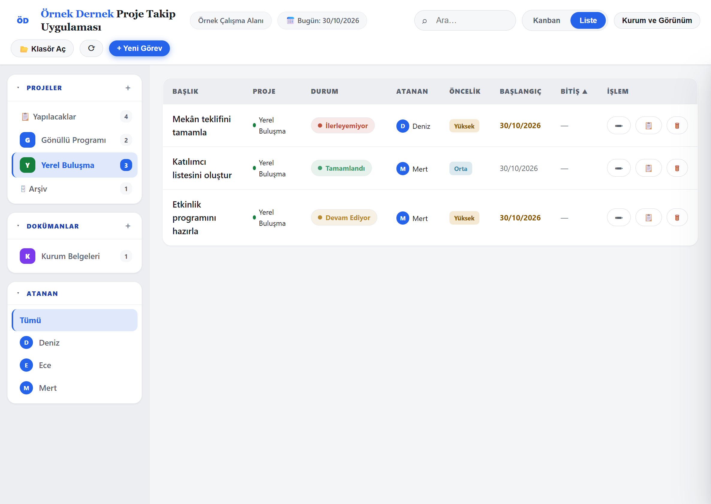

# Proje Takip Uygulaması (Local Project Tracker)

[Türkçe](README.md) | [English](README.en.md)

A local web app that manages your projects, tasks and documents as plain Markdown files **in a folder on your own computer**. No account, no subscription, no server-side database. The Turkish name is *Proje Takip Uygulaması*; in English: *Local Project Tracker*.

> The app's user interface is **Turkish only**. The documentation is provided in Turkish and English.



*The organization, people and records in this screenshot are example data.*

## Why local?

- Built with NGOs and small teams in mind: your data stays in your folder and you do not depend on a hosted service.
- Records are readable `.md` files that open in any text editor and are easy to back up and move.
- The app is served by a small Python server that runs only on this computer (`127.0.0.1`).

## Features

- Kanban and list views; projects, assignees, priority, start/end dates, search and filters
- Statuses: Yapılacak (To do), Devam Ediyor (In progress), Onay Bekliyor (Waiting for approval), İlerleyemiyor (Blocked), Tamamlandı (Done)
- Document lists with validity status, editing and a link field; Markdown preview
- Export a document to `.docx` (in the browser, using a bundled local library)
- Organization name, optional logo, color palette and light/dark appearance

## Download and install

1. [Download the latest release](https://github.com/anilbunny03/proje-takip/releases/latest) and unzip it into a folder.
2. **Requirements:** Python 3 (3.10 or newer recommended) and a desktop Chromium browser such as Chrome or Edge (the File System Access API is required for folder access). Firefox and Safari are not supported.
3. On Windows, double-click `start.bat`. On other systems run `python3 serve.py --open` in the folder.
4. The browser opens `http://localhost:8000/`. On first use, **Klasör Seç** ("Select folder") opens organization setup. Complete it, then click **Klasör Aç** ("Open folder") to choose your data folder.

The app works while the server is running; close its window or press `Ctrl+C` to stop it. If the port is taken: `python3 serve.py --port 8001`.

## Starting with a blank data folder

The release ships **no data**. Create an empty folder (preferably outside the app folder). First complete organization setup with a name and optional logo; then use **Klasör Aç** ("Open folder") to select it and start adding projects and tasks. Details: [User Guide](docs/USER_GUIDE.en.md).

## Privacy and security

- The app has no cloud service, analytics or remote API connection. Libraries are local. Opening an external link contacts that website; sync software may separately transfer files.
- An organization setup draft (name, logo and appearance) may temporarily be cached in browser `localStorage`; task/document content is not stored there.
- The server binds to `127.0.0.1` only by default, accepts only GET/HEAD and serves only the app files — not your data folder.
- Markdown in documents is sanitized; remote images and embedded media are blocked.
- **Limits:** Deletion is permanent (no trash). Data is not encrypted and the app makes no backups. Several people editing the same folder at the same time is unsafe. If your data folder lives in a sync folder such as Google Drive or OneDrive, its content is uploaded to that service.
- Details and disclosure: [SECURITY.md](SECURITY.md)

## Running from source and tests

```bash
python3 serve.py --open
node --test tests/*.test.cjs
python -B -m unittest discover -s tests -p 'test_*.py'
python -B tools/package.py      # builds dist/Proje-Takip-Uygulamasi.zip
```

There are no npm dependencies. Tests need Node.js and Python. See [CONTRIBUTING.md](CONTRIBUTING.md) to contribute.

## Documentation

- [User Guide (EN)](docs/USER_GUIDE.en.md) · [Kullanım Kılavuzu (TR)](docs/USER_GUIDE.tr.md)
- [Changelog](CHANGELOG.md) · [Third-party notices](THIRD_PARTY_NOTICES.md)

## License

[MIT](LICENSE) — Copyright 2026 anilbunny03. Bundled third-party libraries are distributed under their own licenses: [THIRD_PARTY_NOTICES.md](THIRD_PARTY_NOTICES.md).
