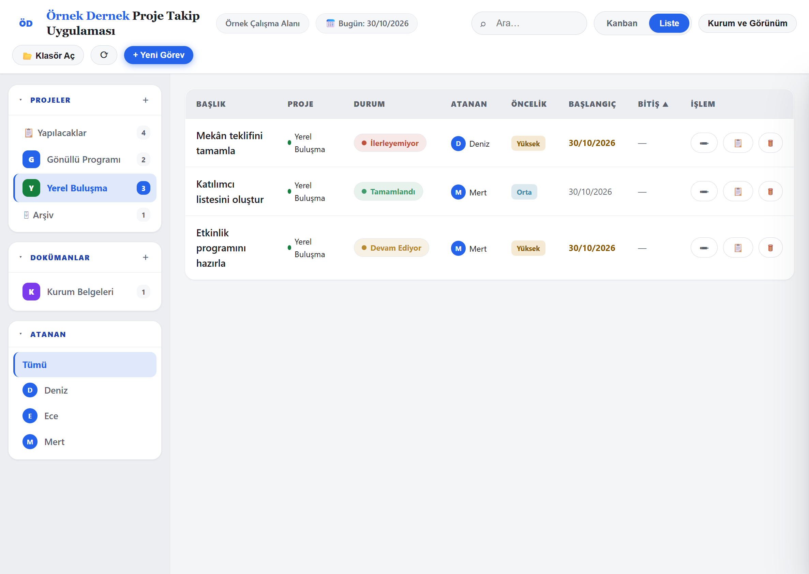

# Proje Takip Uygulaması

[Türkçe](README.md) | [English](README.en.md)

Projelerinizi, görevlerinizi ve dokümanlarınızı **kendi bilgisayarınızdaki bir klasörde**, düz Markdown dosyaları olarak yöneten yerel bir web uygulaması. Hesap yok, abonelik yok, sunucu tarafı veritabanı yok. İngilizce adı: *Local Project Tracker*.

> Uygulama arayüzü **Türkçedir**. Dokümantasyon Türkçe ve İngilizce sunulur.



*Ekran görüntüsündeki kurum, kişiler ve kayıtlar örnek veridir.*

## Neden yerel?

- Sivil toplum kuruluşları ve küçük ekipler için: verileriniz sizin klasörünüzde kalır, bir hizmete bağımlı olmazsınız.
- Kayıtlar okunabilir `.md` dosyalarıdır; herhangi bir metin düzenleyiciyle açılır, yedeklenir, taşınır.
- Uygulama yalnızca bu bilgisayarda çalışan küçük bir Python sunucusuyla sunulur (`127.0.0.1`).

## Özellikler

- Kanban ve liste görünümü; projeler, atanan kişiler, öncelik, başlangıç/bitiş tarihi, arama ve filtre
- Durumlar: Yapılacak, Devam Ediyor, Onay Bekliyor, İlerleyemiyor, Tamamlandı
- Doküman listeleri; geçerlilik durumu, düzenleme ve bağlantı alanı; Markdown önizleme
- Dokümanı `.docx` olarak dışa aktarma (tarayıcıda, paketle gelen yerel kütüphane ile)
- Kurum adı, isteğe bağlı logo, renk paleti ve açık/koyu görünüm ayarı

## İndirme ve kurulum

1. [Son sürümü indirin](https://github.com/anilbunny03/proje-takip/releases/latest) ve zip dosyasını bir klasöre çıkarın.
2. **Gereksinimler:** Python 3 (3.10 veya üzeri önerilir) ve masaüstünde Chrome, Edge gibi bir Chromium tarayıcı (klasör erişimi için File System Access API gerekir). Firefox ve Safari desteklenmez.
3. Windows'ta `start.bat` dosyasına çift tıklayın. Diğer sistemlerde klasörde `python3 serve.py --open` çalıştırın.
4. Tarayıcıda `http://localhost:8000/` açılır. **Klasör Seç** ilk kullanımda kısa kurum kurulumunu açar. Kurulumu tamamladıktan sonra **Klasör Aç** ile veri klasörünüzü seçin.

Sunucu açık kaldığı sürece uygulama çalışır; durdurmak için pencereyi kapatın veya `Ctrl+C` yapın. Port doluysa: `python3 serve.py --port 8001`.

## Boş veri klasörüyle başlama

Sürümle birlikte **hiç veri gelmez**. Boş bir klasör oluşturun (uygulama klasörünün dışında olması önerilir). Önce kurum adını ve isteğe bağlı logoyu tanımlayın; ardından **Klasör Aç** ile bu klasörü seçip proje ve görev ekleyin. Ayrıntılar: [Kullanım Kılavuzu](docs/USER_GUIDE.tr.md).

## Gizlilik ve güvenlik

- Uygulamanın kendi bulut hizmeti, analitiği veya uzak API bağlantısı yoktur. Kütüphaneler yereldir. Açtığınız dış bağlantılar ilgili siteye bağlanır; senkronizasyon yazılımı ayrıca veri aktarabilir.
- Kurulum taslağı (kurum adı, logo ve görünüm) tarayıcı `localStorage` önbelleğinde geçici olarak tutulabilir; görev/doküman içeriği burada saklanmaz.
- Sunucu varsayılan olarak yalnızca `127.0.0.1` adresine bağlanır, sadece GET/HEAD kabul eder ve yalnızca uygulama dosyalarını sunar; veri klasörünüzü sunmaz.
- Dokümanlardaki Markdown temizlenir; uzak görseller ve gömülü medya engellenir.
- **Sınırlar:** Silme kalıcıdır (çöp kutusu yok). Veriler şifrelenmez ve uygulama yedek almaz. Aynı anda birden fazla kişinin aynı klasörü düzenlemesi güvenli değildir. Veri klasörünüz Google Drive/OneDrive gibi bir senkronizasyon klasöründeyse içerik o hizmete yüklenir.
- Ayrıntı ve açık bildirimi: [SECURITY.md](SECURITY.md)

## Kaynaktan çalıştırma ve test

```bash
python3 serve.py --open
node --test tests/*.test.cjs
python -B -m unittest discover -s tests -p 'test_*.py'
python -B tools/package.py      # dist/Proje-Takip-Uygulamasi.zip üretir
```

npm bağımlılığı yoktur. Testler için Node.js ve Python gerekir. Katkı için bkz. [CONTRIBUTING.md](CONTRIBUTING.md).

## Belgeler

- [Kullanım Kılavuzu (TR)](docs/USER_GUIDE.tr.md) · [User Guide (EN)](docs/USER_GUIDE.en.md)
- [Değişiklik günlüğü](CHANGELOG.md) · [Üçüncü taraf bildirimleri](THIRD_PARTY_NOTICES.md)

## Lisans

[MIT](LICENSE) — Telif hakkı 2026 anilbunny03. Paketle gelen üçüncü taraf kütüphaneler kendi lisanslarıyla dağıtılır: [THIRD_PARTY_NOTICES.md](THIRD_PARTY_NOTICES.md).
